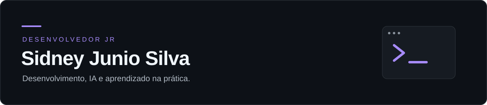

<strong>Desenvolvedor Júnior · IA aplicada ao desenvolvimento · Projetos na prática</strong>

<a href="#sobre-mim">Sobre mim</a> · <a href="#ia-no-meu-dia-a-dia">IA no meu dia a dia</a> · <a href="#o-que-estou-construindo">Projetos</a> · <a href="#minhas-contribuições">Contribuições</a>

## Sobre mim

Olá! Eu sou o **Sidney**, um Desenvolvedor Jr construindo meu caminho com estudo e projetos práticos.

Gosto de pegar um problema real, montar uma primeira versão e ir melhorando com testes e uso. Tenho interesse em aplicativos desktop, interfaces, automação e ferramentas para comunidades.

A inteligência artificial faz parte do meu processo: uso essas ferramentas para aprender, explorar soluções e avançar nos projetos, procurando entender o código e conferir o resultado.

## IA no meu dia a dia

- Uso assistentes de programação para estudar código, investigar erros e comparar alternativas.
- Trabalho com ferramentas como **ChatGPT/Codex e OpenCode** na criação e evolução de projetos.
- Organizo o que quero construir em tarefas menores, testo os fluxos e ajusto o que precisa melhorar.
- Estou desenvolvendo minha capacidade de revisar o que a IA produz, ler documentação e reconhecer os limites de uma solução.

## Conhecimentos em evolução

| Área | O que estou estudando e colocando em prática |
| --- | --- |
| Interfaces | HTML, CSS, JavaScript, organização de telas e experiência de uso |
| Aplicativos e serviços | Electron, Node.js e integração entre interface e backend |
| Dados | SQLite e noções de contas, sessões e permissões |
| Ferramentas | Git, GitHub, publicação com Cloudflare e geração de instaladores Windows |
| IA | Assistentes de código, organização de instruções, prototipação e apoio à depuração |

## O que estou construindo

### Orbe Conect

Um aplicativo para reunir texto, voz e compartilhamento de tela em comunidades pequenas. Estou trabalhando na interface, organização por canais, experiência de uso e distribuição para Windows, com apoio de IA no desenvolvimento.

O projeto está em **beta**, e o acesso entre redes ainda está em configuração. Tenho usado esse trabalho para aprender sobre o ciclo completo: desenvolver, testar, corrigir, empacotar e atualizar.

**[Conheça o Orbe Conect](https://orbe-conect.pages.dev/)** · **[Versões para Windows](https://github.com/sidjrsilva007/orbe-conect-downloads/releases)**

## Meu próximo passo

Quero fortalecer minha base em lógica, JavaScript, organização de código e testes. Meu objetivo é ganhar autonomia para entender melhor as decisões técnicas e construir projetos cada vez mais consistentes.

## Minhas contribuições

<picture>
  <source media="(prefers-color-scheme: dark)" srcset="https://raw.githubusercontent.com/sidjrsilva007/sidjrsilva007/output/github-snake-dark.svg">
  <source media="(prefers-color-scheme: light)" srcset="https://raw.githubusercontent.com/sidjrsilva007/sidjrsilva007/output/github-snake.svg">
  
</picture>

Aprendendo e melhorando um projeto de cada vez.

